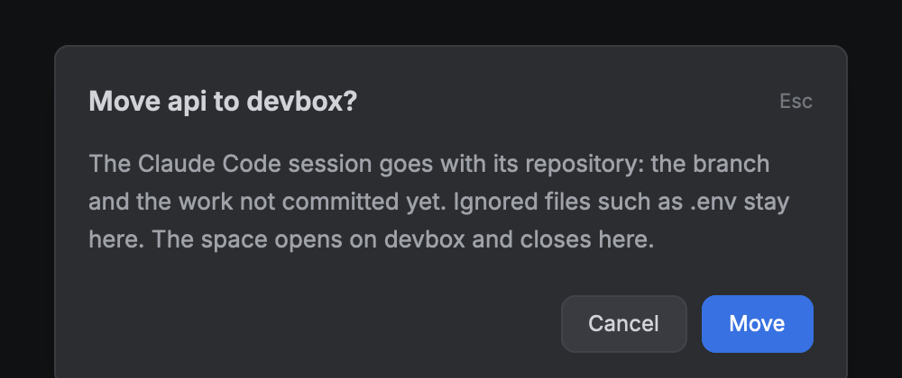

# Teleport for Herdr

Move a [Herdr](https://herdr.dev) space to another of your machines and go on there: its Claude Code
session, and the repository it works in with the work not committed yet. Drop the space on the
machine in the Selan sidebar, or press ⌘⇧M; the space opens on that machine, resuming the
conversation, and closes here.



## Install

You need the Selan CLI 1.35 or later, signed in, here and on each machine you move spaces to, and
those machines added to Herdr over ssh:

```sh
selan update
selan login
```

Then ask the agent in your Herdr window:

> add herdr.dev/mods/selan-ai/herdr-teleport

`add github.com/selan-ai/herdr-teleport` works too. To add it by hand, copy `mods/selan-teleport/`
into `~/.config/herdr-app/mods/`, merge `keys.json` into yours, and run
`herdr-app check ~/.config/herdr-app/mods/selan-teleport`.

Dropping a space on a machine needs a sidebar that opens this mod, as
[herdr-selan](https://github.com/selan-ai/herdr-selan)'s does. With any other, ⌘⇧M moves the space
you are in.

## What moves

`selan teleport` does the moving: the session's transcript goes into the other machine's Claude Code
directory for the same folder under its home, and the repository goes by `git push` over ssh, with
its branch checked out there at the session's commit and the work not committed yet put back on
top, still uncommitted. Ignored files such as `.env` stay here, and a copy there with changes of its
own is refused. A space moves from this computer to a machine Herdr reaches over ssh, macOS or
Linux, when it has one Claude Code agent that is not working.

## What it runs

The mod runs `hc machine ls` and `selan teleport <machine> --json`, which holds your sign-in and
reaches the other machine with your ssh; the mod never sees a token and fetches nothing itself. Then
it opens the space there and closes this one through Herdr. `RECIPE.md` describes the mod in full.

## License

MIT. The preview shows sample data.
