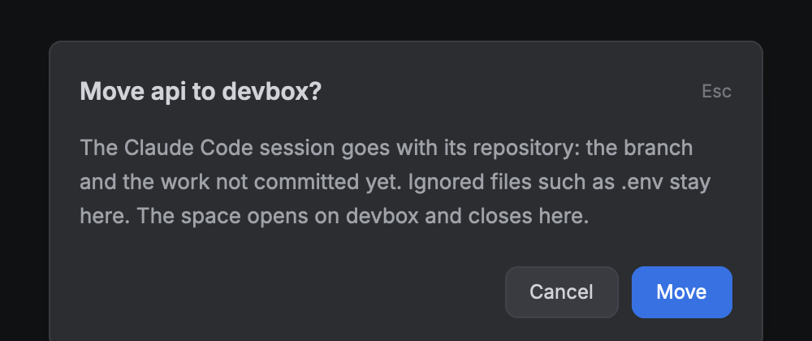

# Teleport

A dialog that moves a space from this computer to another machine: its one Claude Code agent's
session, and the repository the agent works in, go there by `selan teleport --pid --json`, then the space
opens on that machine, resuming the session, and closes here.

## What you see

- **A dialog**, 440 by 190 (`mod.json`'s overlay, and what a sidebar opens it at), `popover`, 18 px
  padding, 12 px between parts, 8 px corners, text 13 px.
- **Title row**: the title at 15 px semibold `foreground`, truncated, and "Esc" at the right in 11 px
  `dim` (gone while moving).
  - "Move <space> to <machine>?" when it can move;
  - "Move <space> to…" while asking where;
  - "Couldn't move <space>" when it cannot.
- **The body**, `muted`, filling the rest and scrolling if it must:
  - ready: "The Claude Code session goes with its repository: the branch and the work not committed
    yet. Ignored files such as .env stay here. The space opens on <machine> and closes here."
  - asking where: one row per machine, 34 px tall, the name in `foreground`, lined up with the title,
    7 px corners, hover `hover`; pressing one asks "Move <space> to <machine>?".
  - moving: Herdr's spinner (13 px, `working`, a turn every 900 ms) beside "Moving to <machine>…".
  - refused: the reason, in a sentence.
- **Buttons**, right-aligned 8 px apart, 32 px tall, 14 px side padding, 8 px corners, 12 px text:
  Cancel (`raised`, `input` border) and Move (`solid`, `solid_foreground`) when ready; Cancel while
  asking where; Close when refused; none while moving.

## How it behaves

- **Opened with props `{ space, tab?, machine }`**, as a sidebar does when a space, or one chat (tab)
  of it, is dropped on a machine: it asks about moving that chat's or that space's agent there.
  **Opened bare** (`mod.open:selan-teleport`): it moves the active space, to the one machine that
  could take it, or asks which.
- **The machines** come from `hc machine ls --json`. One can take a space when it is connected,
  reached over ssh (not `via` a command) and not temporary; its `target` is the ssh name `selan`
  is given.
- **It refuses**, saying why:
  - the space is gone;
  - the space is not on this computer;
  - the machine is unknown, reached by a command, or not connected;
  - no other machine could take it;
  - the chat (or the space) has no Claude Code agent (`program.key` "claude"), or more than one;
  - the agent is working (Herdr's status, and `selan` refuses a session Claude Code lists as busy);
  - Herdr cannot tell the agent's process: `hc get <agent> --json` has no `foreground.pid`.
- **The session** is the one the agent's process has open: `selan` reads it from Claude Code's own
  list of running sessions, so other agents in the same folder do not matter.
- **Move** (or Enter) runs `selan teleport <target> --pid <foreground.pid> --json` in the agent's
  folder (`foreground.cwd`, else its pane's `cwd`), waiting up to 10 minutes. Its answer is one JSON
  object: `folder` (where the session is on that machine) and `resume` (the command that checks out
  the repository and resumes the session there), or `error`.
- **When it moved**: `space.new { machine, folder, argv: resume, focus: true }`, then
  `tab.close { id, confirmed: true }` for a chat of a space with other tabs, else
  `space.close { id, confirmed: true }`, then the dialog closes. Herdr runs `resume` in that machine's
  login shell, so its PATH has `selan`.
- **When it did not**: the error in the dialog. An answer that is not JSON, or a usage error, means a
  selan older than 1.36: "This selan cannot move a session for Herdr: it needs selan 1.36 or later.
  Run selan update." A `selan` that does not start says so and asks whether it is on PATH.
- **Keys**: Enter moves when ready and closes otherwise; Esc closes; neither does anything while
  moving.

## What a sidebar does

A sidebar opens the dialog when a space from this computer, or one chat of it, pressed and dragged,
is let go on another machine: `openOverlay({ mod: "selan-teleport", kind: "dialog", width: 440,
height: 190, props: { space, tab?, machine } })`. It offers the drop only when `mods/selan-teleport/main.js` is in Herdr's
home, and only on a machine that is connected and reached over ssh; while a space is held over such a
header, the header is filled with `selected` and its text is `foreground`.
